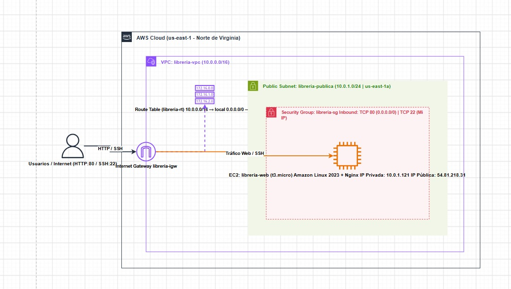
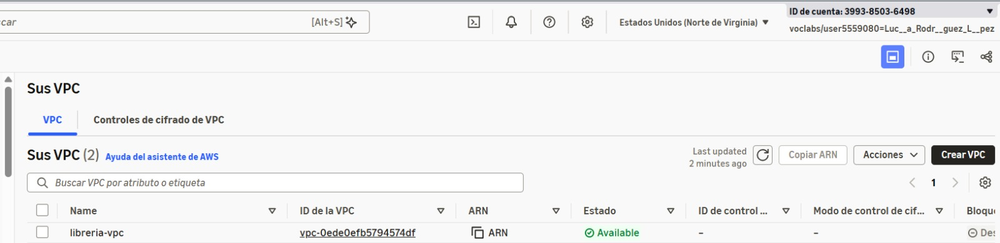
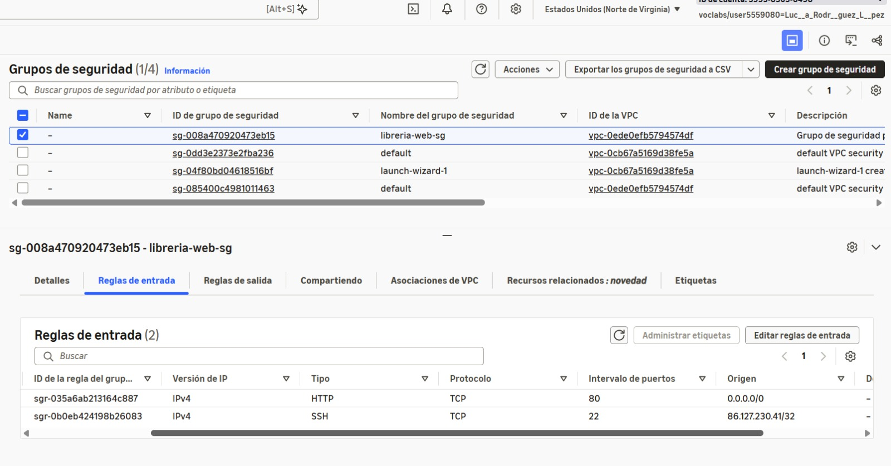
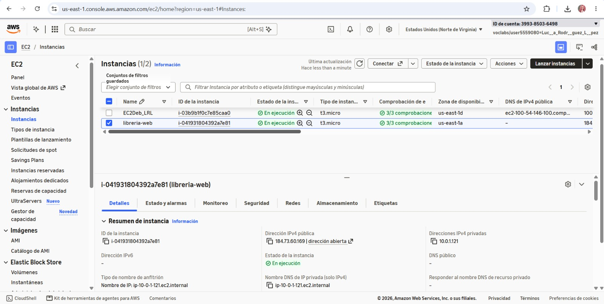
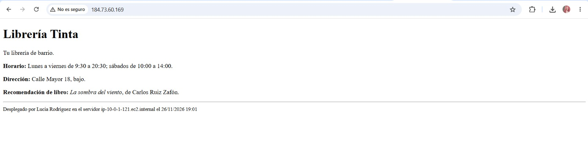

# Nube

# Proyecto 1 — Despliegue de Librería Tinta en AWS

- **Alumna:** Lucía Rodríguez
- **Región:** `us-east-1` (N. Virginia)
- **Vídeo de demostración:** `(https://youtu.be/-2dKSIRPt3w?is=3CnNnBRfdGbuoB69)`

---

## Arquitectura del proyecto

---

## Nivel Básico

### B1. La red (`libreria-vpc`)
Se han creado de forma manual los siguientes recursos de red en `us-east-1`:
- **VPC:** `libreria-vpc` con bloque CIDR `10.0.0.0/16`.
- **Subred pública:** `libreria-publica` (`10.0.1.0/24`) en la zona `us-east-1a`, con asignación automática de IPv4 pública activada.
- **Gateway de internet:** `libreria-igw` adjunto a `libreria-vpc`.
- **Tabla de rutas:** `libreria-rt-publica` asociada a `libreria-publica`, con la ruta `0.0.0.0/0` dirigida a `libreria-igw`.

**¿Por qué la subred es pública?**  
La subred `libreria-publica` es pública porque su tabla de rutas (`libreria-rt-publica`) tiene una ruta por defecto (`0.0.0.0/0`) que apunta directamente a un Internet Gateway (`libreria-igw`), permitiendo la comunicación directa entre las instancias de la subred e Internet.

---

### B2. La seguridad (`libreria-web-sg`)
Se ha configurado el grupo de seguridad `libreria-web-sg` dentro de `libreria-vpc` con las siguientes reglas de entrada:
- **HTTP (puerto 80):** origen `0.0.0.0/0` para permitir que cualquier usuario acceda a la web desde Internet.
- **SSH (puerto 22):** origen restringido exclusivamente a mi IP pública (`/32`).

**¿Por qué el SSH solo se abre a mi IP?**  
El puerto 22 (SSH) permite el acceso administrativo remoto al servidor, restringirlo únicamente a mi IP evita intentos de acceso no autorizado o ataques de fuerza bruta desde cualquier otro punto de Internet.

---

### B3. El servidor web (`libreria-web`)
Se ha lanzado la instancia `libreria-web` (`t3.micro`, Amazon Linux 2023, par de claves `vockey`) dentro de `libreria-vpc` / `libreria-publica` con el grupo de seguridad `libreria-web-sg` y las etiquetas `Proyecto = P1` y `Alumno = Lucía Rodríguez`.

El servidor ejecuta **Nginx** sirviendo por HTTP (`http://184.73.60.169`) la página de **Librería Tinta** con sus datos de horario, dirección, recomendación de libro y pie dinámico con el nombre del servidor (`ip-10-0-1-121.ec2.internal`) y la fecha de despliegue.

- Script de arranque: [`scripts/user-data1.sh`](scripts/user-data1.sh)

---

### B4. Cálculo de costes (1 servidor 24/7 en `us-east-1`)
- **Enlace de AWS Pricing Calculator:** https://calculator.aws/#/estimate?id=cc319e5e77cac00ff2c0958954e0fc1c0064692b
- **Coste mensual estimado:** 7,59 USD/mes (91,08 USD/año para una instancia `t3.micro` Linux bajo demanda en uso constante 24/7).
- **Explicación del presupuesto y cómo abaratar:** Al tratarse de una instancia `t3.micro` bajo demanda encendida las 24 horas en `us-east-1`, el coste mensual es bajo pero constante. Se podría abaratar contratando *Savings Plans* o instancias reservadas frente al pago *Bajo demanda* si el servidor va a estar activo todo el año, o deteniendo la instancia cuando no se utilice fuera del horario de trabajo o pruebas.

---
